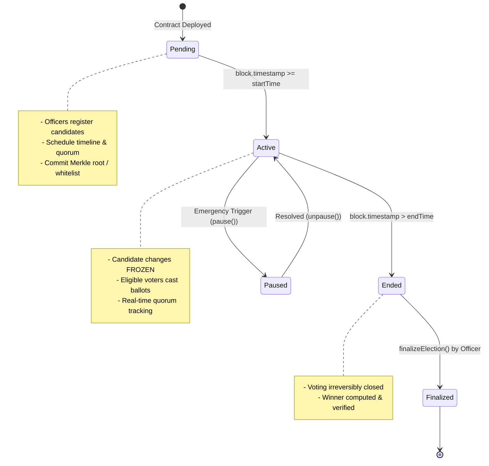
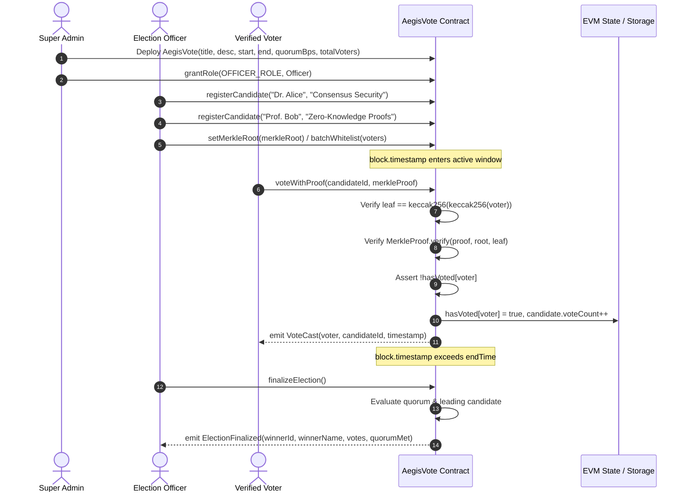

# 🛡️ AegisVote: Institutional-Grade Cryptographic Voting Protocol

[](https://soliditylang.org/)
[](https://www.openzeppelin.com/)
[](https://hardhat.org/)
[-FF3E00?logo=svelte&logoColor=white)](https://kit.svelte.dev/)
[](https://www.typescriptlang.org/)
[](https://tailwindcss.com/)
[](https://github.com/luminariadev/aegis-vote/actions)
[](https://opensource.org/licenses/MIT)

> **AegisVote** is an enterprise-grade, decentralized ballot and governance protocol engineered for distributed systems. Designed to move beyond simplistic voting models, AegisVote implements **Multi-Level Role-Based Access Control (RBAC)**, **Automated Block Time-Locks**, **Cryptographic Merkle Proof Eligibility**, and **Transparent Quorum Tracking** to ensure tamper-proof, auditable, and resilient democratic decision-making on the Ethereum Virtual Machine (EVM).

---

## 📑 Table of Contents

- [Architectural Innovations](#-architectural-innovations)
- [Protocol State Machine](#-protocol-state-machine)
- [Cryptographic Workflow](#-cryptographic-workflow)
- [Smart Contract Specification](#-smart-contract-specification)
- [Tech Stack](#-tech-stack)
- [Quick Start Guide](#-quick-start-guide)
  - [1. Installation](#1-installation)
  - [2. Smart Contract Compilation & Testing](#2-smart-contract-compilation--testing)
  - [3. Local Blockchain Deployment](#3-local-blockchain-deployment)
  - [4. Frontend Execution](#4-frontend-execution)
- [Docker Deployment](#-docker-deployment)
- [Security Auditing & Hardening](#-security-auditing--hardening)
- [Author & License](#-author--license)

---

## 🏛️ Architectural Innovations

Traditional decentralized voting dApps often suffer from single-admin bottlenecks, manual start/stop vulnerabilities, privacy leakage, and high gas costs for voter registration. AegisVote addresses these challenges through five foundational pillars:

### 1. Multi-Level RBAC (`OpenZeppelin AccessControl`)
- **`DEFAULT_ADMIN_ROLE` (Super-Admin):** Governs system-level security, sets emergency pauses, tunes quorum parameters, and manages election commission roles.
- **`OFFICER_ROLE` (Election Commission):** Registers candidate platforms, defines election timelines, and commits voter whitelists or Merkle roots. Cannot tamper with vote counts or bypass time-locks.
- **`VOTER_ROLE` (Verified Electorate):** Granted to authenticated voters on-chain or proven via zero-knowledge-ready Merkle proofs.

### 2. Deterministic Automated Time-Lock
- Election start (`startTime`) and end (`endTime`) are governed strictly by immutable `block.timestamp` transitions.
- Candidate registration is permanently frozen once `startTime` arrives.
- Ballots close automatically when `endTime` passes, preventing late vote injection without requiring an admin transaction.

### 3. Dual-Mode Voter Whitelisting (Direct Role & Merkle Proofs)
- **Direct Role:** Simple on-chain `VOTER_ROLE` for small councils or institutional committees.
- **Merkle Tree Proofs:** Off-chain electorate snapshot hashed into a 32-byte `merkleRoot`. Voters submit cryptographic proofs (`voteWithProof`), slashing gas costs from $O(N)$ storage writes to $O(1)$ verification and preserving voter identity privacy until ballot casting.

### 4. Transparent Quorum & Voter Turnout Tracking
- Configurable quorum threshold measured in basis points (`100 = 1.00%`, `5000 = 50.00%`).
- Dynamic real-time calculation of voter participation rate vs total expected electorate.
- Prevents illegitimate minority takeovers by asserting quorum validity before declaring election finality.

### 5. Circuit-Breaker Resilience (`OpenZeppelin Pausable` & `ReentrancyGuard`)
- Prevents reentrancy vectors during ballot casting.
- Super-admin can trigger emergency circuit-breaker pausing in the event of upstream network anomalies or chain reorganizations.

---

## 🔄 Protocol State Machine



---

## 🔐 Cryptographic Workflow



---

## 💻 Tech Stack

### Core Smart Contract
- **Solidity `^0.8.24`**: Modern EVM smart contract logic with custom gas-efficient errors.
- **OpenZeppelin Contracts `v5.0.2`**: Audited security modules (`AccessControl`, `ReentrancyGuard`, `Pausable`, `MerkleProof`).
- **Hardhat `v2.22.3`**: Automated compile, simulation, and deployment toolchain.
- **Ethers.js `v6.12.0`**: Contract abstraction and typed interaction.
- **MerkleTreeJS & Keccak256**: Cryptographic tree generation and proof verification.

### Frontend Application
- **SvelteKit `v2.0` & Svelte `5.0` (Runes)**: Reactive UI utilizing fine-grained `$state`, `$derived`, and `$props`.
- **Tailwind CSS `v3.4`**: Dark institutional cyber-security design system with custom glow filters and badges.
- **Vite `v5.0` & Vite PWA**: Fast HMR development and progressive web app capabilities.

---

## ⚡ Quick Start Guide

### Prerequisites
- [Node.js](https://nodejs.org/) `>= 20.x`
- [npm](https://www.npmjs.com/) `>= 10.x`
- [MetaMask](https://metamask.io/) or another injected Web3 wallet browser extension.

---

### 1. Installation

Clone repository and install monorepo dependencies:

```bash
git clone https://github.com/luminariadev/aegis-vote.git
cd aegis-vote
```

Install contracts dependencies:
```bash
cd contracts
npm install
```

Install frontend dependencies:
```bash
cd ../frontend
npm install
```

---

### 2. Smart Contract Compilation & Testing

Compile the Solidity source code and generate TypeChain typings:
```bash
cd contracts
npm run compile
```

Run the automated test suite (15 unit & integration tests covering RBAC, Time-Locks, Merkle Proofs, Quorum, and Emergency Controls):
```bash
npm test
```

Expected output:
```text
  AegisVote Protocol
    Deployment & RBAC Configuration
      ✔ Should grant DEFAULT_ADMIN_ROLE and OFFICER_ROLE to deployer
      ✔ Should correctly initialize election parameters
      ✔ Should reject invalid time range during deployment
    Candidate Registration
      ✔ Should allow officer to register candidates before startTime
      ✔ Should revert if unauthorized account tries to register candidates
      ✔ Should reject registration with empty candidate name
      ✔ Should reject candidate registration once election has started
    Time-Lock Enforcement & Direct Whitelist Voting
      ✔ Should revert votes cast before election starts
      ✔ Should allow whitelisted voter to cast vote during active window
      ✔ Should prevent double voting from the same address
      ✔ Should reject non-whitelisted voters
      ✔ Should reject voting once endTime has passed
    Merkle Tree Proof Cryptographic Voting
      ✔ Should allow valid Merkle proof voter to cast vote
    Quorum Calculation & Tabulation
      ✔ Should accurately track quorum threshold and identify winner
    Circuit Breaker & Emergency Controls
      ✔ Should pause and prevent voting during emergency

  15 passing (1s)
```

---

### 3. Local Blockchain Deployment

Spin up a local simulated Hardhat EVM node:
```bash
cd contracts
npx hardhat node
```

In a new terminal window, deploy the AegisVote contract:
```bash
cd contracts
npm run deploy -- --network localhost
```

---

### 4. Frontend Execution

Start the SvelteKit development server:
```bash
cd frontend
npm run dev
```

Open [http://localhost:5173](http://localhost:5173) in your browser. Connect MetaMask to:
- **Network Name:** Hardhat Localhost
- **RPC URL:** `http://127.0.0.1:8545`
- **Chain ID:** `31337`
- **Currency Symbol:** `ETH`

---

## 🐳 Docker Deployment

A multi-stage `Dockerfile` and `docker-compose.yml` are provided for containerized production environments:

```bash
# Build and run containers
docker-compose up -d --build

# View container logs
docker-compose logs -f

# Teardown
docker-compose down
```

The application will be accessible at [http://localhost:3000](http://localhost:3000).

---

## 🛡️ Security Auditing & Hardening

| Vector | Mitigation Strategy in AegisVote |
| :--- | :--- |
| **Reentrancy Attacks** | Contract methods mutate state prior to external calls, protected with OpenZeppelin's `nonReentrant` mutex. |
| **Double-Voting** | Dedicated `mapping(address => bool) public hasVoted` checked and committed atomically during transaction execution. |
| **Sybil & Voter Spoofing** | Dual-mode cryptographic verification: Strict `VOTER_ROLE` enforcement or cryptographic `MerkleProof.verify` against verified tree leaves. |
| **Time-Lock Manipulation** | Bounds are validated using `block.timestamp` against immutable `startTime` and `endTime` stored in contract storage. |
| **Unauthorized Administration** | Role-based permission guards (`onlyRole(DEFAULT_ADMIN_ROLE)` and `onlyOfficer`) with granular hierarchy. |
| **Denial of Service** | Gas-efficient custom errors (`revert ElectionNotActive()`) avoid expensive string allocations on revert. |

---

## 👤 Author & Attribution

- **Developer:** [Rizkia Nuari Fujiana (`luminariadev`)](https://github.com/luminariadev)
- **Email:** `rizkianuari83@gmail.com`
- **Portfolio:** [rizkianuari.vercel.app](https://rizkianuari.vercel.app/)

## 📄 License

This project is licensed under the [MIT License](LICENSE) - feel free to use and adapt for academic, enterprise, and decentralized governance implementations.
